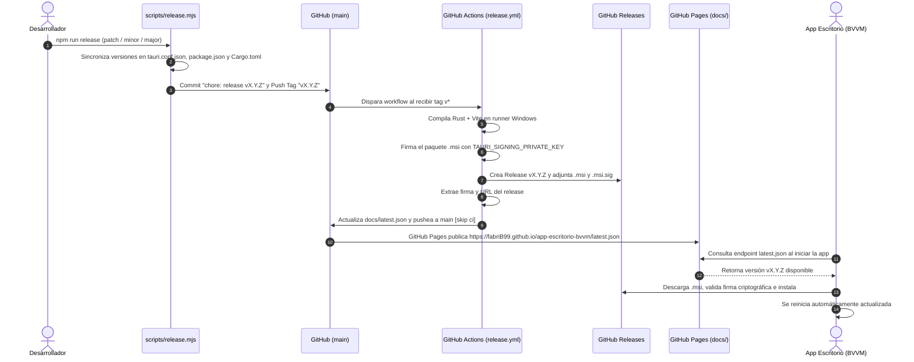

# Guía Completa de Actualizaciones y Publicación de Versiones

Este documento describe el funcionamiento integral del circuito de actualizaciones automáticas del sistema **Control BVVM** (Cuerpo de Bomberos Voluntarios Villa María) para Windows, cómo lanzar nuevas versiones con un solo comando y cómo resolver contingencias.

---

## 1. Arquitectura del Circuito de Actualización

El sistema utiliza el **Auto-Updater nativo de Tauri v2** combinado con **GitHub Actions**, **GitHub Releases** y **GitHub Pages**.



---

## 2. Lanzar una Nueva Versión (Paso a Paso)

Todo el ciclo está automatizado con el script `scripts/release.mjs`.

### Forma 1: Modo Interactivo (Recomendado)

Desde la raíz del monorepo o desde `apps/escritorio/`, ejecutá:

```bash
npm run release
```

El script te guiará con un menú interactivo:

1. **Muestra la versión actual** (leída de `tauri.conf.json`).
2. **Pregunta el tipo de incremento**:
   - `1) Patch`: Correcciones de errores o mejoras menores (ej: `0.3.3` → `0.3.4`).
   - `2) Minor`: Nuevas funciones o pantallas (ej: `0.3.3` → `0.4.0`).
   - `3) Major`: Modificaciones estructurales o breaking changes (ej: `0.3.3` → `1.0.0`).
   - `4) Personalizada`: Permite ingresar cualquier versión `X.Y.Z`.
3. **Solicita las notas de la versión**: Descripción de los cambios que verán los bomberos en la app.
4. **Verifica el estado de Git**: Si tenés cambios sin commitear, podés incluirlos en el mismo commit de release.
5. **Aplica y sincroniza la versión** en:
   - `apps/escritorio/src-tauri/tauri.conf.json`
   - `apps/escritorio/package.json`
   - `apps/escritorio/src-tauri/Cargo.toml`
   - `package.json` (raíz)
6. **Crea el commit**, genera el tag Git (`vX.Y.Z`) y los **pushea a GitHub**.

### Forma 2: Modo Directo / Con Parámetros

Podés pasar argumentos para saltear las preguntas:

```bash
# Incremento patch con notas
npm run release patch -m "Corrección de cálculo en dashboard de guardia"

# Incremento minor con notas
npm run release minor -m "Nuevo módulo de estadísticas de choferes"

# Versión exacta
npm run release 0.4.0 -m "Rediseño de áreas protegidas y legajos"

# Sin confirmaciones (-y)
npm run release patch -m "Ajustes varios" -y

# Solo crear commit y tag local sin pushear
npm run release patch --no-push
```

---

## 3. ¿Qué hace GitHub Actions Automáticamente?

Al pushear el tag `vX.Y.Z`, se dispara el workflow `.github/workflows/release.yml`:

1. **Entorno Windows (`windows-latest`)**: Instala Node.js 22 y Rust estable con caché.
2. **Compilación y Firma (`tauri-apps/tauri-action@v0`)**:
   - Compila el frontend Vite.
   - Compila el backend Rust nativo.
   - Genera el instalador Windows `.msi`.
   - Firma digitalmente el `.msi` con la clave privada configurada en los secrets del repositorio (`TAURI_SIGNING_PRIVATE_KEY` y `TAURI_SIGNING_PRIVATE_KEY_PASSWORD`).
   - Crea la **Release en GitHub** y adjunta el instalador y la firma (`.msi.sig`).
3. **Actualización Automática de `docs/latest.json`**:
   - Hace checkout limpio a la rama `main`.
   - Lee el nombre exacto del archivo `.msi` y el contenido de la firma `.msi.sig` generados en el build.
   - Construye la URL de descarga: `https://github.com/FabriB99/app-escritorio-bvvm/releases/download/vX.Y.Z/Control-BVVM_X.Y.Z_x64_en-US.msi`.
   - Escribe el JSON estructurado en `docs/latest.json`:
     ```json
     {
       "version": "0.3.4",
       "notes": "Notas del lanzamiento...",
       "pub_date": "2026-10-25T15:00:00.000Z",
       "platforms": {
         "windows-x86_64": {
           "signature": "dW50cnVzdGVkIGNvbW1lbnQ6...",
           "url": "https://github.com/FabriB99/app-escritorio-bvvm/releases/download/v0.3.4/Control-BVVM_0.3.4_x64_en-US.msi"
         }
       }
     }
     ```
   - Commitea con `[skip ci]` para no re-disparar workflows.
   - Pushea directamente a la rama `main`.

---

## 4. Configuración de GitHub Pages

Para que las aplicaciones puedan consultar `docs/latest.json`, el repositorio debe tener **GitHub Pages** configurado para servir la carpeta `/docs` de la rama `main`:

1. En el repositorio de GitHub: **Settings** → **Pages**.
2. **Build and deployment**:
   - **Source**: `Deploy from a branch`.
   - **Branch**: `main`.
   - **Folder**: `/docs`.
3. El endpoint público resultante es:
   `https://fabriB99.github.io/app-escritorio-bvvm/latest.json`
4. Este endpoint ya está configurado en `apps/escritorio/src-tauri/tauri.conf.json`:
   ```json
   "plugins": {
     "updater": {
       "active": true,
       "endpoints": [
         "https://fabriB99.github.io/app-escritorio-bvvm/latest.json"
       ],
       "dialog": true,
       "pubkey": "..."
     }
   }
   ```

---

## 5. Detección y Descarga en la App de Escritorio

En `apps/escritorio/src/pages/Inicio/Inicio.tsx`:

- Al montarse la vista, la app ejecuta `check()` de `@tauri-apps/plugin-updater`.
- Si `update.available === true`:
  - Se le notifica al usuario que hay una nueva versión disponible.
  - Al presionar **Actualizar**, se ejecuta `update.downloadAndInstall()`.
  - Tauri valida criptográficamente que la firma del instalador coincida con la `pubkey` embebida en `tauri.conf.json`.
  - Se invoca `relaunch()` para reiniciar la aplicación con la nueva versión instalada.

---

## 6. Secretos de GitHub Requeridos

En el repositorio de GitHub (**Settings** → **Secrets and variables** → **Actions**), deben existir los siguientes secrets:

| Secreto | Descripción |
|---------|-------------|
| `TAURI_SIGNING_PRIVATE_KEY` | Clave privada generada por Tauri CLI para firmar los `.msi`. |
| `TAURI_SIGNING_PRIVATE_KEY_PASSWORD` | Contraseña asignada a la clave privada (o vacía si no tiene). |
| `GITHUB_TOKEN` | Provisto automáticamente por GitHub Actions (requiere permiso `contents: write`, ya declarado en `release.yml`). |

---

## 7. Procedimiento de Contingencia Manual

Si en alguna ocasión GitHub Actions completa la Release pero fallara el push automático de `docs/latest.json` (por ejemplo, por problemas temporales de conectividad de GitHub):

1. Descargá el archivo `.msi.sig` desde la Release recién creada en GitHub.
2. Abrí `.msi.sig` con un editor de texto y copiá todo su contenido (la firma).
3. Modificá `docs/latest.json` localmente:
   - Actualizá `"version"` al número de versión (ej: `"0.3.4"`).
   - En `"signature"`, pegá la firma copiada.
   - En `"url"`, colocá el link de descarga directa del `.msi` en la Release.
   - Actualizá `"pub_date"` con la fecha y hora UTC actual.
4. Hacé commit y push a `main`:
   ```bash
   git add docs/latest.json
   git commit -m "chore: manual update latest.json v0.3.4"
   git push origin main
   ```
